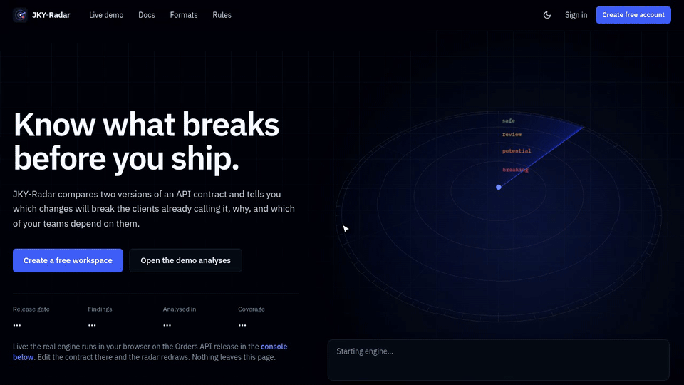
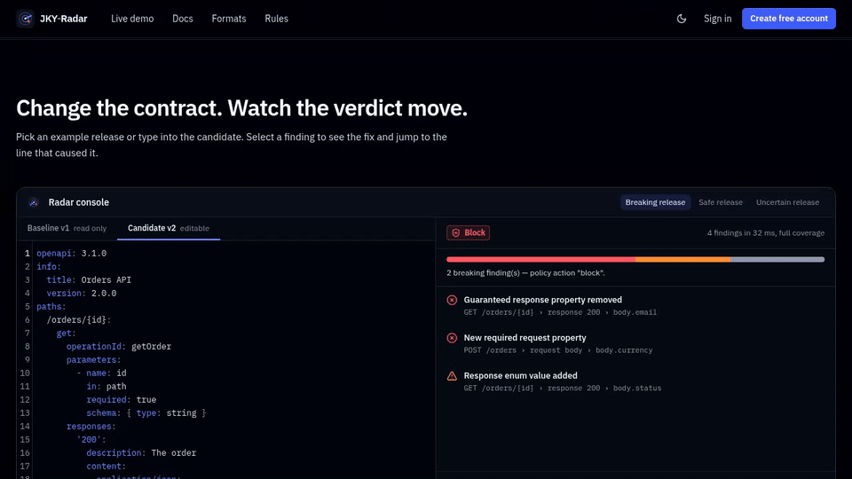
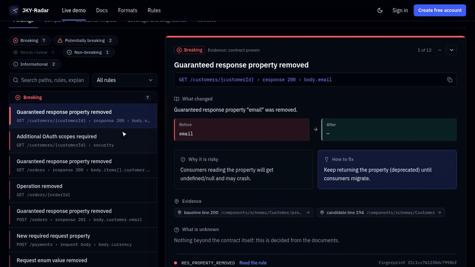
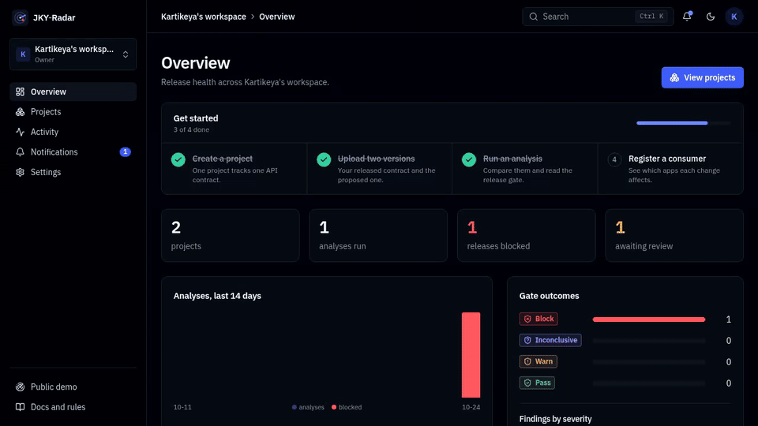
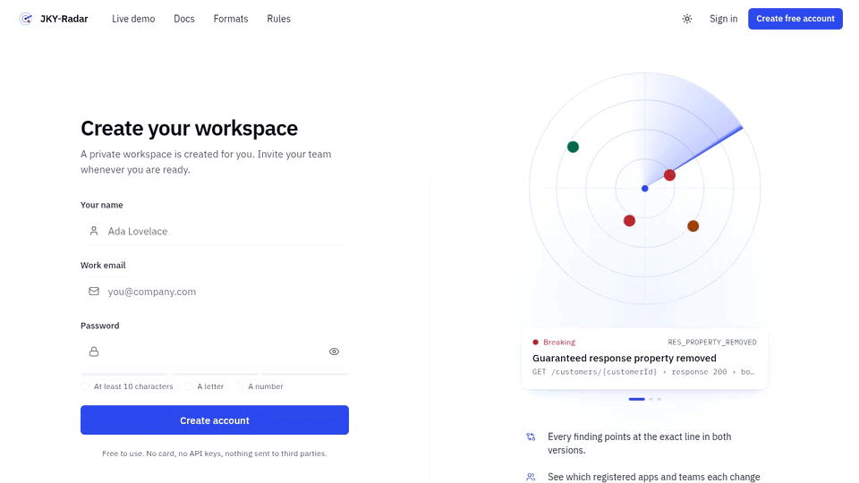
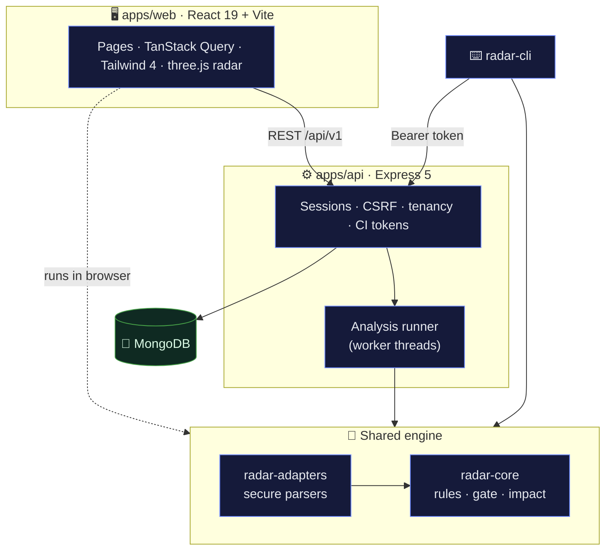

<div align="center">



<br />

[](https://github.com/kartikeyajay2006/JKY-Radar/actions/workflows/ci.yml)    

     

**Compare two versions of an API contract. See exactly which changes break the clients already calling it, why, who is affected, and whether the release should ship.**

[Quick start](#-quick-start) · [See it in action](#-see-it-in-action) · [How it works](#-how-it-works) · [CLI and CI](#-gate-every-pull-request) · [Docs](docs/)

</div>

<br />

<p align="center">
  
</p>

<p align="center">
  <sub>The landing page radar is drawn with <b>three.js</b> from a real analysis running in your browser. Every contact is a finding; the closer to the centre, the more it breaks.</sub>
  <br />
  <a href="docs/media/demo.mp4"><b>▶ Watch the 5-second clip (MP4)</b></a>
</p>

---

## ✨ Highlights

<table>
  <tr>
    <td width="50%" valign="top">
      <h3>🎯 Direction-aware findings</h3>
      A new required field breaks <i>requests</i> but is additive in <i>responses</i>. Every finding has a fixed rule ID, severity, line-accurate evidence in both versions, and a fix.
    </td>
    <td width="50%" valign="top">
      <h3>🚦 An honest release gate</h3>
      <b>Pass</b>, <b>warn</b>, <b>block</b> or <b>inconclusive</b> from a versioned policy. No findings is never reported as safe when coverage is incomplete.
    </td>
  </tr>
  <tr>
    <td valign="top">
      <h3>👥 Consumer impact</h3>
      Register the apps that call your API and the operations they use. Each analysis shows which teams a change affects, by criticality and owner.
    </td>
    <td valign="top">
      <h3>🔁 Gate every pull request</h3>
      An offline CLI with exit codes, plus project-scoped CI tokens so a pipeline can send each candidate to your workspace and get the verdict back.
    </td>
  </tr>
  <tr>
    <td valign="top">
      <h3>🧩 Seven contract formats</h3>
      OpenAPI 3.x, Swagger 2.0, GraphQL, JSON Schema, Postman, Protocol Buffers and AsyncAPI, from any vendor. Each states its real support level.
    </td>
    <td valign="top">
      <h3>🔐 Secure by default</h3>
      Bounded parsing, no remote fetching, secret redaction before storage, worker-thread isolation, CSRF, tenant isolation and an append-only audit log.
    </td>
  </tr>
</table>

---

## 🎬 See it in action

### Change the contract, watch the verdict move

Pick an example release in the in-browser console: the gate flips between **Block** and **Pass**, and selecting a finding jumps to the exact line in the contract.

<p align="center"></p>

### Every finding explains itself

What changed, why it is risky, the evidence in both versions, how to fix it and what cannot be known from documents. Step through findings or filter by severity.

<p align="center"></p>

<table>
  <tr>
    <td width="50%" valign="top">
      <h4>⌘K search anywhere</h4>
      Jump to pages, projects, recent analyses and workspaces from the keyboard.
      
    </td>
    <td width="50%" valign="top">
      <h4>Friendly sign-up</h4>
      A live checklist mirrors the server's password rules as you type.
      
    </td>
  </tr>
</table>

---

## 🧭 How it works

The same deterministic pipeline runs in the browser console, on the server and in the CLI. Identical inputs always produce identical findings and fingerprints.

```mermaid
flowchart LR
    A["📄 Two contract versions"] --> B["🛡️ Parse safely<br/>depth, alias and size limits"]
    B --> C["🧹 Normalise<br/>3.0 nullable = 3.1 type null"]
    C --> D["🔗 Match<br/>methods, paths, fields, RPCs"]
    D --> E["⚖️ Classify<br/>157 direction-aware rules"]
    E --> F["🚦 Gate<br/>named, versioned policy"]
    F --> G["👥 Impact · 📝 Review · 📤 Export"]

    classDef in fill:#1e293b,stroke:#6f8bff,color:#e6e9ef
    classDef step fill:#151a3a,stroke:#a497ff,color:#e6e9ef
    classDef gate fill:#3a1520,stroke:#ff5c61,color:#ffe4e6
    classDef out fill:#0f2a22,stroke:#34c795,color:#dcfce7
    class A in
    class B,C,D,E step
    class F gate
    class G out
```



| Gate                | Meaning                                                                                                        |
| :------------------ | :------------------------------------------------------------------------------------------------------------- |
| 🟢 **Pass**         | No finding needs action, and every construct in both versions was compared by tested rules.                    |
| 🟡 **Warn**         | Nothing confirmed breaking, but some changes could break clients, or coverage is partial.                      |
| 🔴 **Block**        | At least one change will break existing clients under the current policy.                                      |
| 🟣 **Inconclusive** | A change landed in a construct that is not decided formally (such as `oneOf` or a regex). A human has to look. |

---

## 🧩 Supported formats

| Format                                                          | Status                                                               |
| :-------------------------------------------------------------- | :------------------------------------------------------------------- |
| OpenAPI 3.0 / 3.1 (JSON, YAML, local `$ref`)                    | ✅ supported                                                         |
| Swagger / OpenAPI 2.0                                           | ✅ supported                                                         |
| GraphQL SDL and introspection JSON                              | ✅ supported                                                         |
| JSON Schema (draft-04 to 2020-12, request or response polarity) | ✅ supported                                                         |
| Manual REST contract (in-app builder)                           | ✅ supported                                                         |
| Postman Collection v2.1                                         | 🟡 partial: collections are not authoritative, severities are capped |
| OpenAPI 3.2                                                     | 🟡 partial: QUERY and additionalOperations compared                  |
| Protocol Buffers / gRPC (`.proto`)                              | 🟡 partial: single file, wire vs source level                        |
| AsyncAPI 2.x / 3.x                                              | 🧪 experimental                                                      |
| Cross-format HTTP (Swagger 2 ↔ OpenAPI 3, Postman ↔ OpenAPI)    | 🧪 experimental, explicit opt-in                                     |
| Postman v3 multi-file, URL import                               | ⛔ unsupported (detected and explained)                              |

The generated matrix with tested-rule counts and fixture evidence is in [docs/SUPPORT_MATRIX.md](docs/SUPPORT_MATRIX.md). All 157 rules are documented in [docs/RULE_CATALOG.md](docs/RULE_CATALOG.md). "OpenAPI" is the open API description standard and is unrelated to any AI vendor.

---

## 🚀 Quick start

Requirements: **Node.js 22.12+**, npm 10+, and **MongoDB 7** (local or Atlas).

```bash
git clone https://github.com/kartikeyajay2006/JKY-Radar.git
cd JKY-Radar
npm install
cp .env.example .env            # set MONGODB_URI and SESSION_SECRET
npm run dev                     # API on :4000, web on :5173 (Vite proxies /api)
```

Open **http://localhost:5173**. The public demo is seeded automatically by actually running the engine on synthetic fixtures (`npm run seed:demo` to reseed).

> [!TIP]
> No MongoDB installed? `docker compose up --build` starts MongoDB and the app on http://localhost:4000.

---

## 🔁 Gate every pull request

**Offline CLI.** The same engine, no server needed:

```bash
npm run radar -- compare fixtures/openapi/breaking/ecommerce-v1.yaml fixtures/openapi/breaking/ecommerce-v2.yaml
```

```text
JKY-Radar · openapi · gate BLOCK · coverage full
  • 7 breaking finding(s) — policy action "block".

Breaking   RES_PROPERTY_REMOVED         GET /customers/{customerId} › response 200 › body.email
Breaking   HTTP_OPERATION_REMOVED       GET /orders/{orderId}
Breaking   REQ_PROPERTY_REQUIRED_ADDED  POST /payments › request body › body.currency
```

Exit code `1` means the gate failed and `2` means an input could not be parsed. See [examples/github-actions-radar-check.yml](examples/github-actions-radar-check.yml).

**Through your workspace.** Create a token under **Project → CI access** and the analysis lands in the web app next to its findings, impact and reviews:

```bash
JKY_RADAR_TOKEN=jkyr_… npm run radar -- check openapi.yaml --server https://radar.example.com --label "$GIT_SHA"
```

Tokens are project-scoped, shown once, stored as a hash, expire, can be revoked, and act with their creator's permissions (re-checked on every call). Without the CLI, `POST /api/v1/ci/check` does the same from any CI ([docs/API.md](docs/API.md#ci-tokens)).

---

## 🧱 Architecture

A modular **MERN** monorepo in plain JavaScript (ES modules), with types documented in JSDoc and checked by `tsc --checkJs`. The analysis engine is pure JavaScript, shared by the API, the browser and the CLI.



<details>
<summary><b>📁 Repository layout</b></summary>

```
apps/web                 React 19 + Vite + TanStack Query + Tailwind v4 + three.js
apps/api                 Express 5 + Mongoose 8: sessions, tenancy, runner, reports, CI tokens
packages/radar-core      domain model, rule registry, schema comparator, HTTP differ, gate, impact, reports
packages/radar-adapters  secure parsers and adapters per protocol, detection, redaction, engine
packages/shared          Zod request schemas, DTO types, roles and permissions
packages/radar-cli       command-line interface (offline compare, server check)
fixtures/                synthetic contract pairs, expected results, adversarial inputs
```

</details>

<details>
<summary><b>🧰 Scripts</b></summary>

| Command                                       | What it does                                                                                         |
| :-------------------------------------------- | :--------------------------------------------------------------------------------------------------- |
| `npm run dev`                                 | API (`node --watch`) and web (Vite) together                                                         |
| `npm run build`                               | Production build of the web app (the API runs from source)                                           |
| `npm start`                                   | Start the API (serves the web app when `SERVE_WEB=true`)                                             |
| `npm run typecheck` · `lint` · `format:check` | JSDoc type check, ESLint, Prettier                                                                   |
| `npm test`                                    | 494 unit, integration and security tests (needs MongoDB)                                             |
| `npm run test:e2e`                            | Playwright journey, mobile and accessibility tests (`PW_CHROMIUM_PATH` can point at a system Chrome) |
| `npm run seed:demo`                           | Idempotent public demo seed                                                                          |
| `npm run docs:matrix`                         | Regenerate the support matrix and rule catalog from code                                             |
| `npm run check`                               | typecheck + lint + test + build                                                                      |

</details>

More: [architecture](docs/ARCHITECTURE.md) · [decisions](docs/DECISIONS.md) · [REST API](docs/API.md) · [deployment](docs/DEPLOYMENT.md)

---

## 🔐 Security

Opaque server-side sessions (argon2id, HttpOnly SameSite cookies, rotation, revoke-all), session-bound CSRF tokens, a strict CSP without inline scripts, tenant authorisation on every resource (other workspaces return 404), hashed and revocable CI tokens, secret redaction before storage, no remote `$ref` or URL fetching, bounded YAML/JSON parsing, worker-thread isolation with time and memory limits, rate limits and an append-only audit log. Details in [docs/SECURITY.md](docs/SECURITY.md).

## ✅ Testing

| Layer         | Coverage                                                                                                                                                                                                                                |
| :------------ | :-------------------------------------------------------------------------------------------------------------------------------------------------------------------------------------------------------------------------------------- |
| 🧠 **Engine** | 156 tested rules, each with a positive and a negative case; 15 fixture pairs must reproduce their gate; 26 adversarial inputs (alias bombs, prototype pollution, remote refs, ReDoS patterns, binary content and more) must fail safely |
| ⚙️ **API**    | Integration and security tests against real MongoDB: sessions, CSRF, IDOR and role escalation, immutability, uploads, analyses, reports, reviews, CI tokens, rate limiting, worker isolation                                            |
| 🎭 **E2E**    | Playwright journey from registration to PDF export, CI token and pipeline gate, command palette, mobile layout, and axe-core WCAG 2.1 AA checks in both themes                                                                          |

Current status and evidence: [docs/STATUS.md](docs/STATUS.md).

## ⚠️ Limitations

JKY-Radar compares documents; it does not observe live traffic. `oneOf`/`anyOf`/`not`, conditionals and regex patterns are flagged for review rather than decided. Impact covers registered consumers only. Protobuf imports are not resolved. Password recovery by email is not implemented. The full list appears in every report and in the app's docs.

---

<div align="center">

**Built with MongoDB, Express, React and Node.js**

[MIT](LICENSE) © Kartikeya Yadav

</div>
