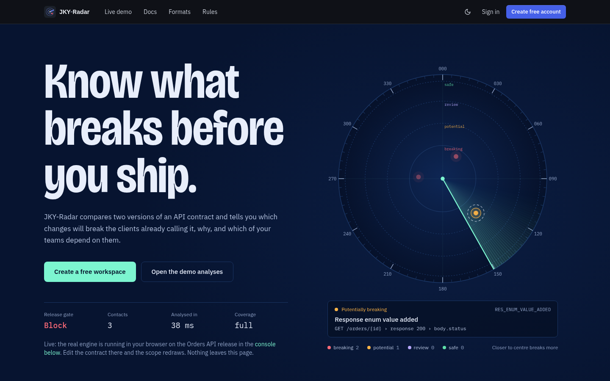
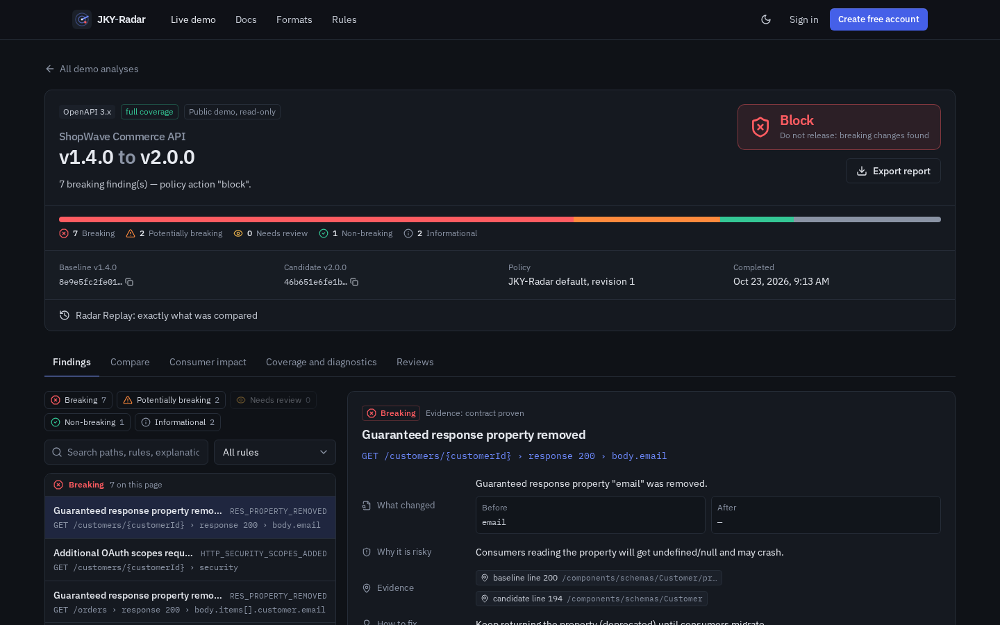
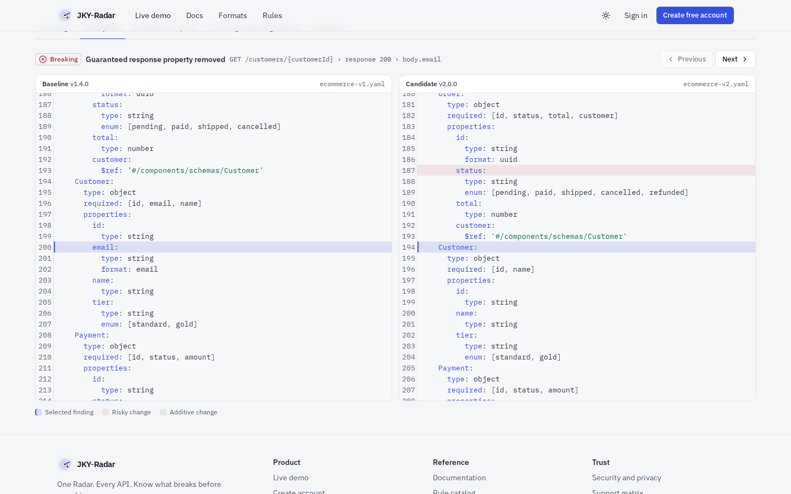
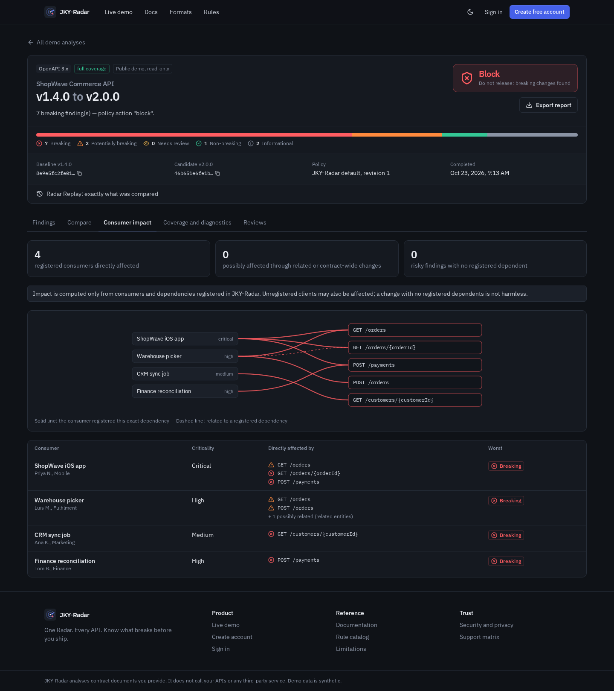
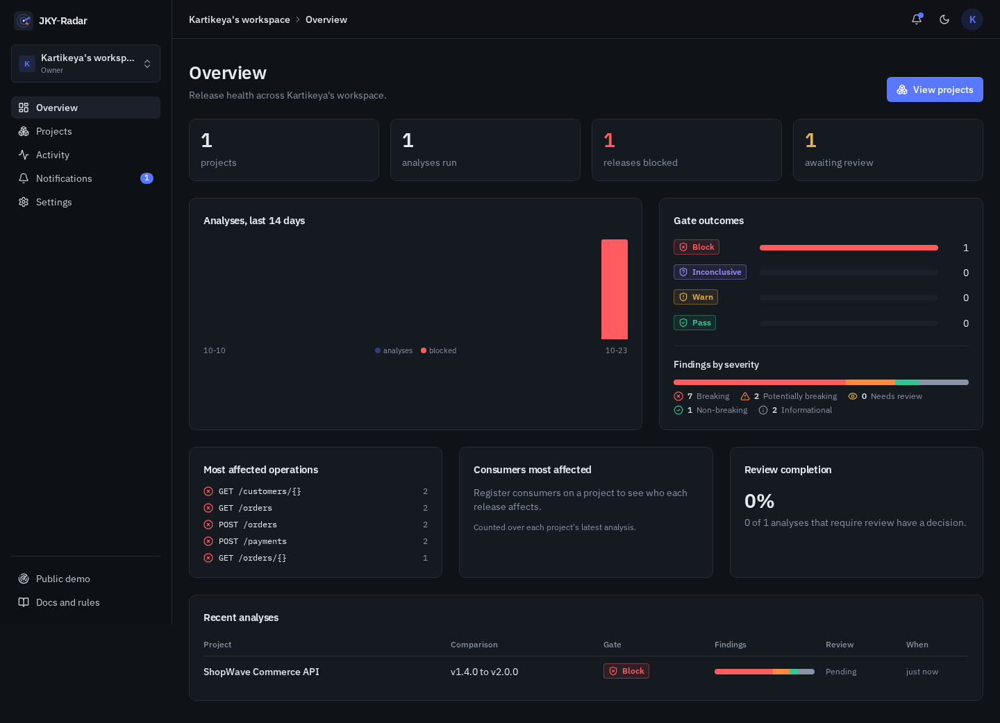

<div align="center">


# JKY-Radar

**One Radar. Every API. Know What Breaks Before You Ship.**

Vendor-neutral API contract compatibility analysis. Compare two versions of an API contract, see exactly what changed, which changes break existing clients, which registered consumers are affected, and get a release gate you can defend.

[](https://github.com/kartikeyajay2006/JKY-Radar/actions/workflows/ci.yml)


</div>



## What it does

You upload (or paste, or build by hand) two versions of a contract. JKY-Radar parses both safely, normalises dialect differences, matches operations and types by stable keys, runs a versioned rule registry with direction-aware semantics, and produces:

- **Findings** with a fixed rule ID, severity, line-accurate source pointers into both versions, and an explanation of _what changed, why it is risky, the evidence, how to fix it, and what cannot be known from documents alone_.
- **A release gate** (`pass`, `warn`, `block`, `inconclusive`) from a named, versioned policy. No findings is never reported as safe when coverage is incomplete.
- **Consumer impact** against the applications you register and the operations they declare, without pretending to discover usage it cannot see.
- **Reviews and an audit trail**: approve, reject, request changes; overriding a blocked gate needs a written rationale.
- **Exports** as JSON (machine-readable), Markdown and a branded PDF generated in Node.js.

"OpenAPI" is the open API description standard; it is unrelated to any AI vendor. JKY-Radar treats contracts from your own services, GitHub, Stripe, internal platforms or anyone else the same way.

## Supported formats

| Format                                                          | Status                                                            |
| --------------------------------------------------------------- | ----------------------------------------------------------------- |
| OpenAPI 3.0 / 3.1 (JSON, YAML, local `$ref`)                    | supported                                                         |
| Swagger / OpenAPI 2.0                                           | supported                                                         |
| GraphQL SDL and introspection JSON                              | supported                                                         |
| JSON Schema (draft-04 to 2020-12, request or response polarity) | supported                                                         |
| Manual REST contract (in-app builder)                           | supported                                                         |
| Postman Collection v2.1                                         | partial: collections are not authoritative, severities are capped |
| OpenAPI 3.2                                                     | partial: QUERY and additionalOperations compared                  |
| Protocol Buffers / gRPC (`.proto`)                              | partial: single file, wire vs source level                        |
| AsyncAPI 2.x / 3.x                                              | experimental                                                      |
| Cross-format HTTP (Swagger 2 ↔ OpenAPI 3, Postman ↔ OpenAPI)    | experimental, explicit opt-in                                     |
| Postman v3 multi-file, URL import                               | unsupported (detected and explained)                              |

The full, generated matrix with tested-rule counts and fixture evidence is in [docs/SUPPORT_MATRIX.md](docs/SUPPORT_MATRIX.md). All 157 rules are documented in [docs/RULE_CATALOG.md](docs/RULE_CATALOG.md).

## Screens

| Findings with explainability                        | Compare with source highlights                    |
| --------------------------------------------------- | ------------------------------------------------- |
|  |  |
| **Consumer impact graph**                           | **Workspace overview**                            |
|      |     |

## Quick start

Requirements: Node.js 22.12+ (CI uses 22; Node 24 LTS also works), npm 10+, and MongoDB 7 (local or Atlas).

```bash
git clone https://github.com/kartikeyajay2006/JKY-Radar.git
cd JKY-Radar
npm install
cp .env.example .env            # set MONGODB_URI and SESSION_SECRET
npm run dev                     # API on :4000, web on :5173 (Vite proxies /api)
```

Open http://localhost:5173. The public demo is seeded automatically (`DEMO_SEED_ENABLED=true`) by actually running the engine on the synthetic fixtures. To seed manually: `npm run seed:demo`.

No MongoDB installed? `docker compose up --build` starts MongoDB and the app on http://localhost:4000.

### Offline CLI

The same engine runs without a server:

```bash
npm run radar -- compare fixtures/openapi/breaking/ecommerce-v1.yaml fixtures/openapi/breaking/ecommerce-v2.yaml
npm run radar -- compare old.graphql new.graphql --format json --fail-on warn
npm run radar -- capabilities
```

Exit code 1 means the gate failed, 2 means an input could not be parsed. See [examples/github-actions-radar-check.yml](examples/github-actions-radar-check.yml) for gating pull requests.

### Gate releases through the server

Create a token under **Project → CI access**, store it as a CI secret, and send each candidate to the server. The analysis lands in the web app with its findings, impact and reviews, and the exit code follows the project's release policy:

```bash
JKY_RADAR_TOKEN=jkyr_… npm run radar -- check openapi.yaml --server https://radar.example.com --label "$GIT_SHA"
```

Without the CLI, `POST /api/v1/ci/check` does the same from any CI (see [docs/API.md](docs/API.md#ci-tokens)).

## Scripts

| Command                                                       | What it does                                                   |
| ------------------------------------------------------------- | -------------------------------------------------------------- |
| `npm run dev`                                                 | API (`node --watch`) and web (Vite) together                   |
| `npm run build`                                               | Production build of the web app (the API runs from source)     |
| `npm start`                                                   | Start the built API (serves the web app when `SERVE_WEB=true`) |
| `npm run typecheck` / `npm run lint` / `npm run format:check` | JSDoc type check, ESLint, Prettier                             |
| `npm test`                                                    | 494 unit, integration and security tests (needs MongoDB)       |
| `npm run test:e2e`                                            | Playwright journey, mobile and accessibility tests             |
| `npm run seed:demo`                                           | Idempotent public demo seed                                    |
| `npm run docs:matrix`                                         | Regenerate the support matrix and rule catalog from code       |
| `npm run check`                                               | typecheck + lint + test + build                                |

## Architecture

A modular MERN monolith written in plain JavaScript (ES modules). Types are documented with JSDoc and checked by `npm run typecheck` (`tsc --checkJs`, no TypeScript source files). The analysis engine is pure JavaScript, shared by the API, the browser playground and the CLI.

```
apps/web            React 19 + Vite + TanStack Query + Tailwind v4
apps/api            Express 5 + Mongoose 8, sessions, tenancy, runner, reports
packages/radar-core      domain model, rule registry, schema comparator, HTTP differ, gate, impact, reports
packages/radar-adapters  secure parsers and adapters per protocol, detection, redaction, engine
packages/shared          Zod request schemas, DTO types, roles and permissions
packages/radar-cli       offline command-line interface
fixtures/                synthetic contract pairs, expected results, adversarial inputs
```

Details: [docs/ARCHITECTURE.md](docs/ARCHITECTURE.md) · decisions: [docs/DECISIONS.md](docs/DECISIONS.md) · REST API: [docs/API.md](docs/API.md).

## Security

Opaque server-side sessions (argon2id passwords, HttpOnly SameSite cookies, rotation, revoke-all), session-bound CSRF tokens, strict CSP without inline scripts, tenant authorisation on every resource (other workspaces return 404), secret redaction before storage, no remote `$ref` or URL fetching, bounded YAML/JSON parsing, worker-thread isolation with time and memory limits, rate limits, and an append-only audit log. See [docs/SECURITY.md](docs/SECURITY.md).

## Testing

- **Engine**: every one of the 156 tested rules has a positive and a negative case; 15 fixture pairs must reproduce their expected gate; 26 adversarial inputs (alias bombs, deep nesting, prototype pollution, remote refs, duplicate keys, ReDoS patterns, binary content and more) must fail safely; determinism and SDL vs introspection consistency.
- **API**: integration and security tests against a real MongoDB: sessions, CSRF, IDOR and role escalation, immutability, uploads, analyses, reports, reviews, rate limiting, cache headers, worker isolation.
- **E2E**: Playwright journey from registration to PDF export, mobile layout, and axe-core WCAG 2.1 AA checks in both themes.

Current status and evidence: [docs/STATUS.md](docs/STATUS.md).

## Deployment

One Node web service serving both the API and the SPA from the same origin, plus MongoDB Atlas. A Render blueprint (`render.yaml`) and a Dockerfile are included. See [docs/DEPLOYMENT.md](docs/DEPLOYMENT.md).

## Limitations

JKY-Radar compares documents; it does not observe live traffic. oneOf/anyOf/not, conditionals and regex patterns are flagged for review rather than decided. Impact covers registered consumers only. Protobuf imports are not resolved. Password recovery by email is not implemented. The full list is in every report and in the app's docs.

## License

[MIT](LICENSE) © Kartikeya Yadav
