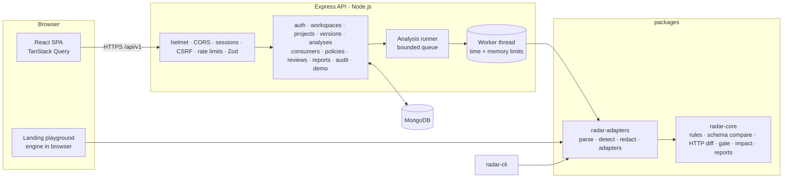

# Architecture

A modular MERN monolith: one Express API, one React SPA, one MongoDB database, and pure TypeScript analysis packages that are also used by the browser playground and the CLI. No microservices, no external paid services.

## Packages

| Package               | Responsibility                                                                                                                                                                                                     | Depends on                                     |
| --------------------- | ------------------------------------------------------------------------------------------------------------------------------------------------------------------------------------------------------------------ | ---------------------------------------------- |
| `@jky/radar-core`     | Domain types, rule registry (157 rules), emitter, dialect-aware schema normaliser, polarity-aware schema comparator, HTTP differ, coverage, release gate, consumer impact, JSON/Markdown report rendering. No I/O. | —                                              |
| `@jky/radar-adapters` | Bounded JSON/YAML parser with source positions, structural format detection, secret redaction, adapters for each protocol, the `analyzeContracts` orchestrator and the capability registry.                        | core, yaml, graphql, protobufjs                |
| `@jky/shared`         | Zod request schemas, DTO types, roles, permissions and limits shared by API and web.                                                                                                                               | core, zod                                      |
| `@jky/radar-cli`      | Offline CLI with gate-based exit codes.                                                                                                                                                                            | adapters, core                                 |
| `@jky/api`            | Express 5 app, Mongoose models, authorisation, services, PDF reports, demo seeding.                                                                                                                                | all packages                                   |
| `@jky/web`            | React SPA.                                                                                                                                                                                                         | shared, core, adapters (lazy, playground only) |

## Analysis pipeline

1. **Limit and decode.** Byte cap, UTF-8 check, NUL rejection.
2. **Redact.** Secret-looking values are replaced before anything is stored or hashed.
3. **Detect.** By structure and version fields (`openapi`, `swagger`, `asyncapi`, `__schema`, SDL keywords, proto syntax), never by file name alone. A user override must not contradict a high-confidence detection.
4. **Parse.** Custom JSON parser with positions, duplicate-key and depth checks; YAML via `yaml` with the core schema only, no custom tags or merge keys, bounded alias expansion; every object built with `defineProperty` (no `__proto__` pollution).
5. **Normalise.** OpenAPI 3.0 `nullable` → type null, legacy boolean exclusive bounds → numeric, Swagger `file`/`x-nullable`/`formData`/`collectionFormat`, simple `allOf` merging. Local `$ref`s resolve to shared nodes (cycle-safe); remote refs are recorded, never fetched.
6. **Match.** HTTP: method + normalised path template (`/orders/{}`), operationId for path/method moves, positional path params. GraphQL: schema coordinates. Protobuf: field numbers. AsyncAPI: channel address and operation ID.
7. **Classify.** Protocol differs emit rule IDs through the `FindingEmitter`; the schema comparator applies request (input) or response (output) polarity and caches per schema pair so shared components are reported at each usage site.
8. **Coverage and gate.** Ignored constructs and coverage-gap findings lower coverage; the policy maps severities to actions, applies justified overrides without rewriting findings, and returns `block`, `inconclusive`, `warn` or `pass`.
9. **Persist.** Findings in their own collection (paginated, indexed), analysis summary with versions, hashes and timings.

## Data model (MongoDB)

| Collection                          | Notes                                                                       |
| ----------------------------------- | --------------------------------------------------------------------------- |
| `users`                             | unique email, argon2id hash, `sessionVersion` for revoke-all                |
| `sessions`                          | SHA-256 of the opaque token, CSRF salt, TTL index on `expiresAt`            |
| `workspaces`, `memberships`         | unique `(workspaceId, userId)`, role, invitation status                     |
| `projects`                          | unique `(workspaceId, slug)`, protocol, latest version/analysis             |
| `specfiles`, `specversions`         | immutable (update hooks throw), unique `(projectId, rawHash)`               |
| `policies`                          | immutable revisions, unique `(projectId, revision)`                         |
| `analyses`                          | unique `(projectId, inputHash)` for idempotency, state/stage for resumption |
| `findings`                          | immutable, indexed by analysis + index/severity/rule, workspace + entity    |
| `consumers`, `consumerdependencies` | normalised dependency keys for impact joins                                 |
| `reviews`, `auditevents`            | append-only                                                                 |
| `notifications`                     | per recipient, unread index                                                 |

## Execution model

The API enqueues analyses in an in-process queue with bounded concurrency. State lives in MongoDB: on startup, queued or interrupted analyses are reset and re-run (deterministic inputs make this safe). In production each analysis runs in a `worker_threads` worker with a heap limit and a wall-clock timeout; development and tests can run inline. Free hosting tiers that sleep are fine because nothing depends on in-memory timers surviving.

## Frontend

React Router data routes with route-level code splitting, TanStack Query for all server state (no fetch calls inside presentational components), Radix primitives for dialogs, menus, tabs and tooltips, CodeMirror 6 (lazy) for code views, Tailwind v4 with CSS-variable tokens for both themes. The landing playground imports the engine lazily and runs it entirely in the browser.
